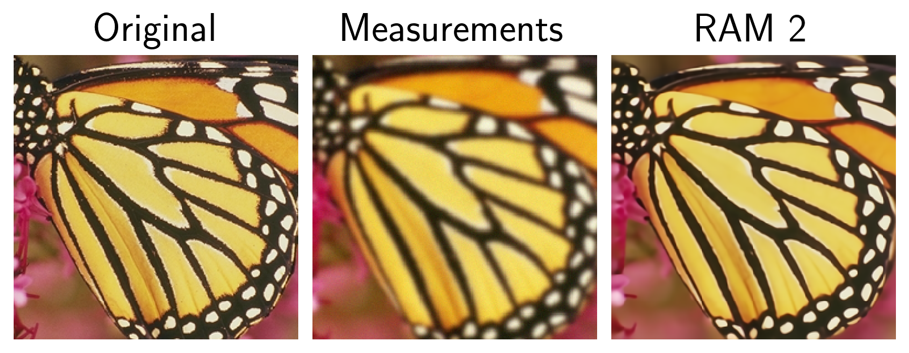
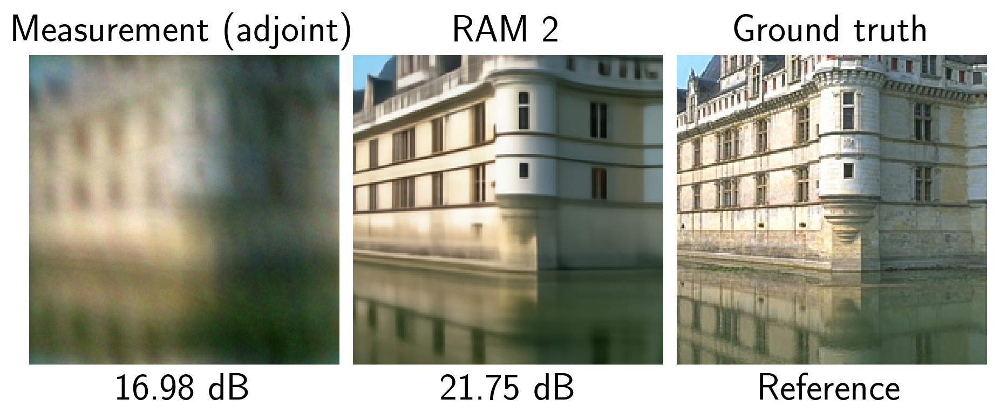
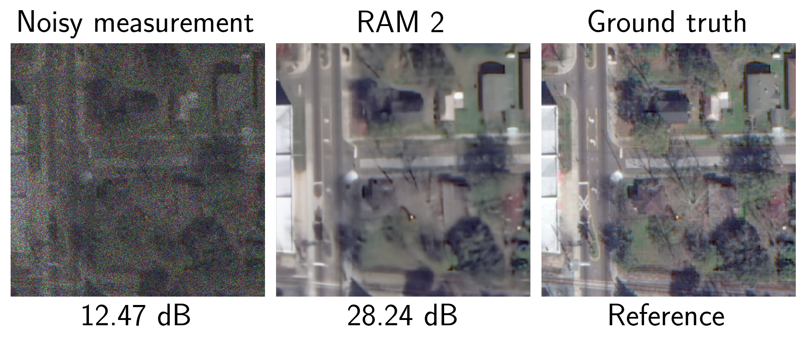
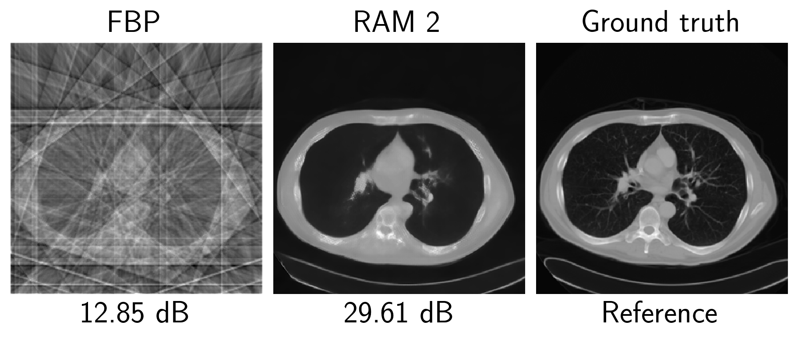
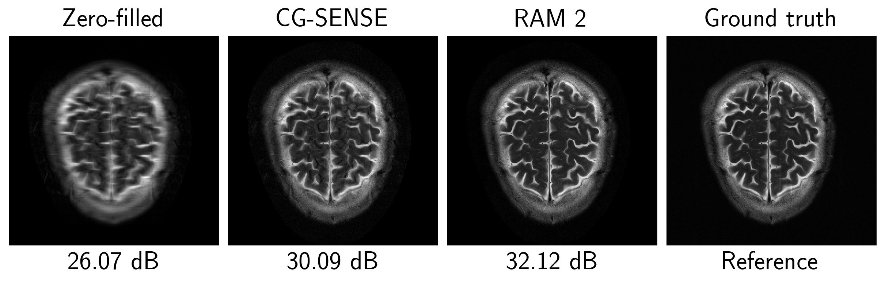

# Blur Labs Open Imaging Models

> Foundation models for computational imaging from [Blur Labs](https://www.blurlabs.ai/): one network that reconstructs images from the measurements of any
> imaging system, with no retraining per task.

## Reconstruct Anything Models (RAM)
RAM solves general imaging problems of the form `y = N(Ax)`,  where `A` models the deterministic acquisition model, 
and `N` some noise degradation. To solve this problem, RAM takes as 
inputs i) the measurements `y`, ii) the acquisition physics `A` and iii) the noise level(s), and returns
the reconstructed image. 

RAM covers any 2D imaging problem, from photography, microscopy to medical imaging (MRI, CT, ...), and any other problem
the forward operator of which can be written with [DeepInverse](https://deepinv.org), that provides
[a large collection of imaging operators](https://deepinv.org/user_guide/physics/physics.html): denoising, deblurring,
demosaicing, super-resolution, PET, ultrasound, inpainting, (multi-coil) MRI, CT, and many more.

This repository holds all open-source versions of the model. **RAM 2** is the latest version: since the first Reconstruct Anything Model
([ICLR 2026](https://matthieutrs.github.io/ram-page/)), we have improved the architecture and training significantly.
RAM 2 outperforms RAM on all imaging tasks, and per task, performs better than or close to state-of-the-art specialized models _trained specifically and only on one task_. See the [blog post](https://www.blurlabs.ai/ram2/) for a summary of results.

### Versions

| Version   | Class                  | Parameters | Paper / results                                                                                            | Weights                                             | License |
|-----------|------------------------|---|------------------------------------------------------------------------------------------------------------|-----------------------------------------------------|---|
| **RAM 2** | `blurlabs.models.RAM2` | 359M | [blog post](https://www.blurlabs.ai/ram2/)                                                                                          | [Hugging Face](https://huggingface.co/blurlabs/ram2) | [GPL-3.0-only](LICENSE). For alternative commercial license, contact [Blur Labs](https://www.blurlabs.ai/) |
| RAM 1     | `deepinv.models.RAM`   | 36M | [ICLR'26 paper](https://proceedings.iclr.cc/paper_files/paper/2026/file/babb3447efd22f411ec90db3bbd38d01-Paper-Conference.pdf), [project page](https://matthieutrs.github.io/ram-page/) | [Hugging Face](https://huggingface.co/mterris/ram)  | [BSD-3-Clause](https://github.com/deepinv/deepinv/blob/main/LICENSE) |


## Installation

Install the latest release directly from GitHub:

```bash
python3 -m pip install "blurlabs @ git+https://github.com/BlurLabsAI/blurlabs.git"
```

For an editable source installation with the example dependencies:

```bash
git clone https://github.com/BlurLabsAI/blurlabs.git
cd blurlabs
python3 -m pip install -e ".[examples]"
```

The RAM 2 weights are gated. First request access on [HuggingFace](https://huggingface.co/blurlabs/ram2), then run
`hf auth login` or set the `HF_TOKEN` environment variable. Weights are downloaded on first use.

## Quick start

```python
import torch
import deepinv as dinv
from blurlabs.models import RAM2

device = dinv.utils.get_device()
model = RAM2().to(device)  # downloads the pretrained weights

x = dinv.utils.load_example("butterfly.png", img_size=256).to(device) # dummy image

physics = dinv.physics.Blur(
    filter=dinv.physics.functional.blur.gaussian_blur(sigma=(2.0, 2.0)),
    noise_model=dinv.physics.GaussianNoise(0.01),
    device=device,
)

y = physics(x) # simulate measurements

with torch.no_grad():
    x_hat = model(y, physics)

dinv.utils.plot([x, y, x_hat], ["Original", "Measurements", "RAM 2"])
```

<p align="center"></p>

Notes:

- 2D images are represented as tensors of shape `B,C,H,W` , with `C=1` (grayscale), `C=2` (real and imaginary parts, e.g. MRI) or `C=3` (RGB) channels, of any size.
- Noise levels are read from `physics.noise_model`, or given with the keywords `sigma` (Gaussian), `gain` (Poisson)
  and `l` (Gamma). `sigma` given alone is used as the exact noise standard deviation, scalar or per pixel.
  For denoising, per-pixel maps extend their boundary values into RAM 2's internal padding,
  matching the padding convention for scalar `sigma`; the supplied map is not modified.
  Single-pixel images retain the existing zero-valued padding for both scalar and map noise levels.
- With `physics=None`, RAM 2 is a denoiser: `model(y, sigma=0.1)`.

### Examples

Install the example dependencies with `pip install -e ".[examples]"`. Model weights and example data are
downloaded on first use.

Below, we provide a few examples of usage of RAM 2 on various image reconstruction problems.

> **Tip**:
> 
> RAM 2 can be used as a drop-in replacement for any [existing example in DeepInverse](https://deepinv.org/auto_examples/index.html).

#### Motion deblurring

```python
import torch
import deepinv as dinv
from blurlabs import RAM2

device = dinv.utils.get_device()
torch.manual_seed(0)

model = RAM2().to(device).eval()
x = dinv.utils.load_example("CBSD_0010.png", img_size=(200, 200), device=device)

physics_generator = (
        dinv.physics.generator.MotionBlurGenerator((31, 31), l=2.0, sigma=2.4, device=device)
        + dinv.physics.generator.SigmaGenerator(sigma_min=0.001, sigma_max=0.2, device=device)
)

# Draw noise and blur parameters at random
parameters = physics_generator.step(seed=0)

physics = dinv.physics.BlurFFT(
    img_size=x.shape[1:],
    filter=parameters["filter"],
    noise_model=dinv.physics.GaussianNoise(parameters["sigma"]),
).to(device)

# Generate simulated measurements
y = physics(x)

with torch.no_grad():
    x_lin = physics.A_adjoint(y)
    x_hat = model(y, physics)

psnr = dinv.metric.PSNR()
linear_psnr = psnr(x_lin, x).item()
ram2_psnr = psnr(x_hat, x).item()

dinv.utils.plot(
    {"Measurement (adjoint)": x_lin, "RAM 2": x_hat, "Ground truth": x},
    subtitles=[f"{linear_psnr:.2f} dB", f"{ram2_psnr:.2f} dB", "Reference",],
    figsize=(6, 4),
)
```

<p align="center"></p>

#### Satellite image denoising

```python
import torch
import deepinv as dinv
from blurlabs import RAM2

device = dinv.utils.get_device()
torch.manual_seed(0)

model = RAM2().to(device).eval()
x = dinv.utils.load_example("JAX_018_011_RGB.tif", device=device)[..., :300, :300]

physics = dinv.physics.Denoising(noise_model=dinv.physics.PoissonGaussianNoise(sigma=0.1, gain=0.1))

y = physics(x)

with torch.no_grad():
    x_hat = model(y, physics)

psnr = dinv.metric.PSNR()
measurement_psnr = psnr(y, x).item()
ram2_psnr = psnr(x_hat, x).item()

dinv.utils.plot(
    {"Noisy measurement": y, "RAM 2": x_hat, "Ground truth": x,},
    subtitles=[f"{measurement_psnr:.2f} dB", f"{ram2_psnr:.2f} dB", "Reference",],
    figsize=(6, 4),
)
```

<p align="center"></p>

#### Sparse-view tomography

```python
import torch
import deepinv as dinv
from blurlabs import RAM2

device = dinv.utils.get_device()
torch.manual_seed(0)

model = RAM2().to(device).eval()
x = dinv.utils.load_example("CT100_256x256_0.pt", device=device)

physics = dinv.physics.Tomography(img_width=x.shape[-1], angles=10, normalize=True, device=device)

y = physics(x)

with torch.no_grad():
    x_fbp = physics.A_dagger(y, fbp=True)
    x_hat = model(y, physics)

psnr = dinv.metric.PSNR()
fbp_psnr = psnr(x_fbp, x).item()
ram2_psnr = psnr(x_hat, x).item()

dinv.utils.plot(
    {"FBP": x_fbp, "RAM 2": x_hat, "Ground truth": x},
    subtitles=[f"{fbp_psnr:.2f} dB", f"{ram2_psnr:.2f} dB", "Reference"],
    figsize=(6, 4),
)
```

<p align="center"></p>

#### Multicoil MRI

We here show a reconstruction example on simulated multicoil MRI reconstruction.

Note that in multicoil MRI, there is a phase (gauge) ambiguity in the coil sensitivity maps. 
RAM 2 assumes that the coil estimates absorb low-frequency phase information, which is also the case for [ESPIRiT with phase correction](https://onlinelibrary.wiley.com/doi/10.1002/mrm.26191), E2E-VarNet or PromptMR+.

For example, you can use `dinv.physics.MultiCoilMRI.estimate_coil_maps` together with `dinv.physics.MultiCoilMRI.phase_correct_maps` to get coil maps that are compatible with RAM 2. Better coil map estimation can improve performance further,
please get in touch with [Blur Labs](https://www.blurlabs.ai/) for more information.


```python
import torch
from torch.utils.data import DataLoader

import deepinv as dinv
from blurlabs import RAM2

device = dinv.utils.get_device()
torch.manual_seed(0)

cache = dinv.utils.get_cache_home()
filename = "file_brain_AXT2_200_2000341.h5"
measurement_root = cache / "fastmri_brain_multicoil_test"
target_root = cache / "fastmri_brain_multicoil_test_full"

dinv.datasets.download_archive(dinv.utils.get_image_url("demo_fastmri_brain_multicoil_test_file_brain_AXT2_200_2000341.h5"), measurement_root / filename,)
dinv.datasets.download_archive(dinv.utils.get_image_url("demo_fastmri_brain_multicoil_test_full_file_brain_AXT2_200_2000341.h5"), target_root / filename,)

dataset = dinv.datasets.FastMRISliceDataset(
    measurement_root,
    target_root=target_root,
    slice_index="middle",
    transform=dinv.datasets.MRISliceTransform(),
    use_dict_output=True,
)

batch = next(iter(DataLoader(dataset)))
x = batch["x"].to(device)
y = batch["y"].to(device)
mask = batch["params"]["mask"].to(device)

# DeepInverse estimates these maps with SigPy's ESPIRiT implementation.
coil_maps = dinv.physics.MultiCoilMRI.estimate_coil_maps(y, calib_size=24, espirit_crop=0.85).to(device)

physics = dinv.physics.MultiCoilMRI(img_size=y.shape[-2:], mask=mask, coil_maps=coil_maps, device=device)

model = RAM2().to(device).eval()

with torch.no_grad():
    x_zf = physics.A_adjoint(y)
    physics.phase_correct_maps(x_zf)
    x_zf = physics.A_adjoint(y)

    # Conjugate-gradient SENSE reconstruction with the same calibrated physics.
    x_sense = physics.A_dagger(y)

    # Raw FastMRI k-space is below RAM 2's minimum noise scale. Normalize the
    # measurement for inference, then restore the acquisition's original scale.
    input_scale = x_zf.abs().amax().item()
    y_normalized = y / input_scale

    # Estimate the noise level in the measurement domain
    noise_sigma = dinv.models.WaveletNoiseEstimator()(y_normalized).item()

    x_hat = model(y_normalized, physics, sigma=noise_sigma) * input_scale

# Match the FastMRI target convention: crop, then take the RSS magnitude.
x_zf = physics.rss(physics.crop(x_zf, shape=x.shape), multicoil=False)
x_sense = physics.rss(physics.crop(x_sense, shape=x.shape), multicoil=False)
x_hat = physics.rss(physics.crop(x_hat, shape=x.shape), multicoil=False)

psnr = dinv.metric.PSNR(max_pixel=None)

zf_psnr = psnr(x_zf, x).item()
sense_psnr = psnr(x_sense, x).item()
ram2_psnr = psnr(x_hat, x).item()

print(f"Estimated sigma: {noise_sigma:.4f}")

dinv.utils.plot(
    {"Zero-filled": x_zf, "CG-SENSE": x_sense, "RAM 2": x_hat, "Ground truth": x},
    subtitles=[f"{zf_psnr:.2f} dB", f"{sense_psnr:.2f} dB", f"{ram2_psnr:.2f} dB", "Reference"],
    figsize=(8, 4),
)

```

<p align="center"></p>

## Want help?

Please raise a GitHub issue, get in touch with [Blur Labs](https://www.blurlabs.ai/), or email us at [hello@blurlabs.ai](mailto:hello@blurlabs.ai). We'd love to help you out! 

### Debugging reconstructions

RAM 2 can report the operator norm, the noise levels and the range of the image the network sees, and flag inputs
outside the training conditions:

- **the image range is above 1**: set `rescale_inputs` to the suggested value; the model returns `a * f(y / a)`.
- **the image range is negative** (below -0.5 for complex images): check the normalisation of the data (offset or
  sign).
- **the least-squares solve is far from converged**: the operator is probably badly calibrated (wrong adjoint or
  norm, wrong noise level), or the problem is extremely ill-posed. Check it with `physics.adjointness_test` and
  `physics.compute_norm`, and use a better physics estimator to estimate any unknown parameters.

`max_iter` (default 30) sets the number of least-squares iterations used to build the input of the network.

### License

RAM 2 and the original code in this repository are released under the
[GNU General Public License v3.0 only](LICENSE). Any use, including commercial use, must comply with the GPL-3.0
terms. For alternative commercial licensing, please [contact Blur Labs](https://www.blurlabs.ai/).

RAM 1 is a separate model distributed by DeepInverse under the
[BSD 3-Clause License](https://github.com/deepinv/deepinv/blob/main/LICENSE). Importing it through
`blurlabs.RAM` does not change or replace its BSD-3-Clause license.

## Going further

At Blur Labs, we've trained further versions of RAM 2 in-house that provide even higher performance tailored to your use-case, such as:

- **RAM 3D**, that reconstructs 3D volumes, surpassing 2D and 3D SotA performance on all 3D medical and industrial problems;
- **Hardware-tailored RAM** that offers RAM 2 performance but optimised for device;
- **Physics parameter estimators** beyond classical physics estimators, to boost RAM performance, such as PSF calibration, automatic noise estimation, physics geometry refinement;
- **API access** to quickstart RAM 2, and our internal versions, without hosting locally.

Interested? Get in touch with [Blur Labs](https://www.blurlabs.ai/) or email directly at [hello@blurlabs.ai](mailto:hello@blurlabs.ai) to discuss your use case and demo our most performant models on your data.
